<picture>
  <source media="(prefers-color-scheme: dark)" srcset="./banner.svg?v=1">
  <source media="(prefers-color-scheme: light)" srcset="./banner-light.svg?v=1">
  
</picture>

  

 

## What I'm building

| Project | What it does | Stack |
| --- | --- | --- |
| [Multi-PDF RAG System](https://github.com/AyushKhatri-Dev/Multi-PDF-RAG-System) | Chat with several PDFs at once, with the source of every answer shown | Python, LangChain, vector DB |
| [AI Startup Validator](https://github.com/AyushKhatri-Dev/AI-STARTUP-VALIDATOR) | Researches a startup idea on the web and scores it | LangGraph, Tavily, Groq, PostgreSQL |
| [AI Meeting Assistant](https://github.com/AyushKhatri-Dev/AI-Meeting-Assistant) | Transcribes meetings, writes summaries and action items, answers questions about them | Whisper, LangChain, ChromaDB |
| [Auretrix](https://github.com/AyushKhatri-Dev/Auretrix-package) | Python speech-to-text library with fallback across providers and 12+ Indian languages | Python, PyPI |
| [pinterestvid.com](https://pinterestvid.com) | Live Pinterest video downloader | Astro, Vercel, yt-dlp |
| [Search Intelligence capstone](https://ayushkhatri-dev.github.io/flyrank-search-intelligence) | Finds pages that underperform on CTR for their search position | Python, Jupyter |

## Open source

| Where | Pull request | Status |
| --- | --- | --- |
| Django | [#18837](https://github.com/django/django/pull/18837) RTL padding fix in `FilteredSelectMultiple` | Merged |

## Contribution activity

  

<picture>
  <source media="(prefers-color-scheme: dark)" srcset="https://raw.githubusercontent.com/AyushKhatri-Dev/AyushKhatri-Dev/output/github-snake-dark.svg">
  <source media="(prefers-color-scheme: light)" srcset="https://raw.githubusercontent.com/AyushKhatri-Dev/AyushKhatri-Dev/output/github-snake.svg">
  
</picture>

## Connect

<!-- Apna email/LinkedIn daalke neeche wali lines ka comment hata do:

-->

  

